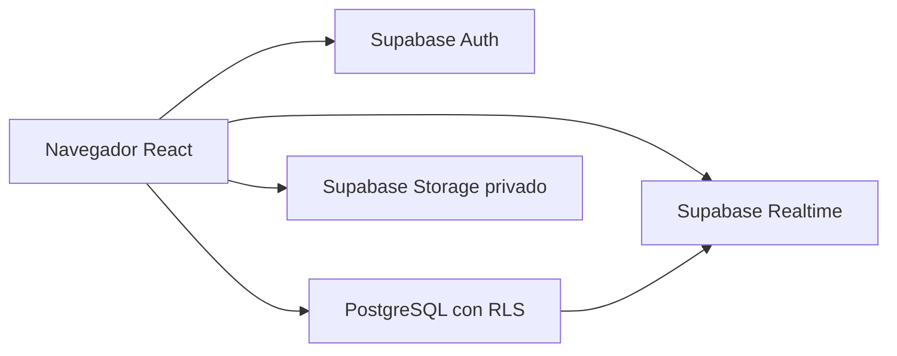

# Arquitectura propuesta

## Resumen

Sky Logic sera una SPA privada publicada en GitHub Pages. React usa Supabase como backend
administrado para autenticacion, PostgreSQL, almacenamiento privado y actualizaciones en
tiempo real.

No se implementara un backend FastAPI separado. Las reglas criticas de asignacion,
disponibilidad, cantidades e integridad quedaran en PostgreSQL mediante restricciones,
transacciones, funciones y Row Level Security.

## Pila tecnologica

| Capa | Tecnologia |
|---|---|
| Frontend | React, TypeScript, Vite |
| UI | Tailwind CSS, Lucide React, Motion, Recharts |
| Navegacion | HashRouter |
| Datos | Supabase PostgreSQL |
| Identidad | Supabase Auth |
| Archivos | Supabase Storage privado |
| Tiempo real | Supabase Realtime, solo para cambios operativos relevantes |
| Publicacion | GitHub Pages y GitHub Actions |

## Principios

1. PostgreSQL es la fuente de verdad.
2. Los activos tienen identidad unica y hoja de vida.
3. Las asignaciones son temporales y no permanentes.
4. Las operaciones confirman cambios mediante transacciones.
5. Los movimientos confirmados no se borran.
6. Las correcciones generan eventos nuevos.
7. Los catálogos pueden desactivarse sin borrar historia.
8. Los seriales se validan como únicos cuando existen.
9. Las reglas de seguridad se aplican en la base de datos.
10. El frontend no es la primera ni la unica linea de validacion.

## Diagrama lógico



## Modulos funcionales

- Dashboard ejecutivo
- Activos y fichas de vida
- Drones, controles y baterias
- Equipos auxiliares
- Operaciones y devoluciones parciales
- Horas de vuelo
- Mantenimiento
- Inventario y movimientos
- Fincas y ubicaciones
- Auditoria
- Usuarios, roles y permisos
- Reportes y exportaciones
- Configuracion de catalogos

## Estructura actual

```text
skylogicmanagement/
  README.md
  docs/
    architecture.md
    database.md
    security.md
    implementation-plan.md
    setup.md
  public/
    brand/
      logo.jpg
  src/
    components/
      FlightChart.tsx
    lib/
      supabase.ts
    App.tsx
    index.css
  supabase/
    migrations/
      20261125130000_initial_schema.sql
  .github/
    workflows/
      deploy-pages.yml
```

La estructura funcional se ampliará a medida que se construyan los módulos:

```text
src/
  app/
  components/
  features/
  lib/
  services/
  styles/
  types/
supabase/
  migrations/
.github/
  workflows/
```
