# Modelo de datos

## Modelo entidad-relacion

```mermaid
erDiagram
    ORGANIZATIONS ||--o{ MEMBERSHIPS : tiene
    AUTH_USERS ||--o{ MEMBERSHIPS : participa
    ROLES ||--o{ MEMBERSHIPS : asigna
    MEMBERSHIPS ||--o| USER_PROFILES : identifica
    ROLES ||--o{ ROLE_PERMISSIONS : concede
    PERMISSIONS ||--o{ ROLE_PERMISSIONS : define

    ORGANIZATIONS ||--o{ ASSETS : registra
    ASSET_TYPES ||--o{ ASSETS : clasifica
    LOCATIONS ||--o{ ASSETS : ubica
    ASSETS ||--o| DRONE_DETAILS : especializa
    ASSETS ||--o| BATTERY_DETAILS : especializa
    ASSETS ||--o{ ASSET_ASSIGNMENTS : vincula
    ASSETS ||--o{ ASSET_ASSIGNMENTS : recibe

    FARMS ||--o{ OPERATIONS : destino
    OPERATIONS ||--o{ OPERATION_ASSETS : incluye
    ASSETS ||--o{ OPERATION_ASSETS : participa
    PILOTS ||--o{ OPERATION_ASSETS : opera
    OPERATIONS ||--o{ FLIGHT_LOGS : registra
    ASSETS ||--o{ FLIGHT_LOGS : dron

    ASSETS ||--o{ MAINTENANCE_RECORDS : recibe
    MAINTENANCE_RECORDS ||--o{ INVENTORY_MOVEMENTS : consume
    INVENTORY_ITEMS ||--o{ INVENTORY_MOVEMENTS : suministra
    INVENTORY_ITEMS ||--o{ INVENTORY_LOCATION_BALANCES : desglosa
    LOCATIONS ||--o{ INVENTORY_LOCATION_BALANCES : almacena
    LOCATIONS ||--o{ INVENTORY_MOVEMENTS : origen_destino
    ASSETS ||--o{ INVENTORY_MOVEMENTS : relaciona

    ASSETS ||--o{ DOCUMENTS : documenta
    OPERATIONS ||--o{ DOCUMENTS : adjunta
    MAINTENANCE_RECORDS ||--o{ DOCUMENTS : adjunta

    ORGANIZATIONS ||--o{ AUDIT_EVENTS : audita
    AUTH_USERS ||--o{ AUDIT_EVENTS : ejecuta
    ASSETS ||--o{ AUDIT_EVENTS : afecta
    OPERATIONS ||--o{ AUDIT_EVENTS : relaciona
```

## Entidades principales

### Organizacion e identidad

- `organizations`: tenant de la plataforma.
- `auth_users`: identidad administrada por Supabase Auth.
- `memberships`: relacion usuario-organizacion.
- `user_profiles`: nombre visible y datos de contacto de cada miembro.
- `roles`: papel asignado al usuario.
- `permissions`: accion autorizada.
- `role_permissions`: permisos efectivamente concedidos a un rol.
- `asset_statuses`, `operation_statuses`, `maintenance_types`: etiquetas administrables
  para códigos de estado y tipo estables.

El modelo inicial puede ser monopropietario. El campo de organizacion se conserva para
aislar datos y evitar acoplar las tablas a una unica empresa.

### Activos

`assets` contiene la identidad comun:

- codigo interno
- nombre
- tipo
- marca
- modelo
- numero de serie opcional
- fecha de adquisicion
- proveedor
- factura o documento de compra
- valor
- estado
- ubicacion
- responsable
- observaciones
- estado activo/inactivo

`drone_details` contiene datos propios del dron:

- horas de vuelo acumuladas, nulas mientras no existan registros
- horas desde el último mantenimiento, nulo mientras no se conozca
- ultimo mantenimiento
- intervalo preventivo siguiente

`battery_details` contiene ciclos de carga —nulos mientras no se conozcan— y datos
técnicos disponibles.

Los controles son activos normales con su propio registro de hoja de vida.
Al crear un dron o batería, un trigger crea automáticamente su ficha específica.
Los seriales son únicos dentro de la organización cuando tienen valor. Los activos
iniciales se cargan como **sin verificar**, sin inventar su estado físico ni ubicación.

### Relaciones temporales

`asset_assignments` representa relacion temporal entre activos, responsables, drones,
operaciones o ubicaciones.

Cada asignacion conserva:

- activo
- destino
- tipo de relacion
- fecha de inicio
- fecha de fin
- motivo
- usuario que la registró

La hoja de vida consulta en modo lectura la ficha actual y los registros relacionados
de `audit_events`, `operation_assets`, `asset_assignments`, `flight_logs`,
`maintenance_records` e `inventory_movements`. Cada origen se consulta solo si el usuario
tiene el permiso de lectura correspondiente; no se amplían políticas RLS ni se modifica
el historial persistido.

La migración `20261125160000_asset_assignment_workflows.sql` agrega funciones
transaccionales `assign_asset` y `end_asset_assignment`, autorizadas con
`operations.manage`. Los cambios de responsable realizados desde la ficha también se
sincronizan en `asset_assignments`; la migración registra como línea base los responsables
ya existentes. Los componentes se vinculan a un dron con una asignación temporal. Una
asignación se libera con fecha de fin, sin reescribir ni borrar el evento. La aplicación
solo muestra controles de gestión a usuarios autorizados y la base de datos vuelve a
validar estado, pertenencia a la organización y operaciones abiertas.

No se utiliza una relacion permanente para equipos auxiliares.

### Operaciones

`operations` contiene el identificador visible, finca, municipio, ubicacion, fechas,
estado, operador principal, responsable, entrega y recepcion.

`operation_assets` representa cada activo incluido en una operacion. Conserva estado de
salida, estado de regreso, entrega, recepcion, devolucion parcial y observaciones.

Los usuarios con `operations.manage` pueden editar los datos descriptivos de operaciones
abiertas y finalizadas (finca, municipio, ubicación y observaciones). Las operaciones
canceladas, las fechas, el estado y los registros de activos permanecen protegidos para
conservar la trazabilidad. Esta regla se aplica en la base de datos mediante la migración
`20261127140000_allow_completed_operation_edits.sql`.

Los usuarios con `operations.manage` pueden eliminar permanentemente una operación y sus
registros de vuelo y asignación. Las horas totales y desde el último mantenimiento se
ajustan en la misma transacción; los eventos de auditoría se conservan. Por seguridad, la
operación se rechaza si algún activo aún no ha regresado. Los adjuntos se eliminan del
almacenamiento después de confirmar el borrado en la base de datos.

`pilots` es el catálogo de personal de vuelo sin usuario de autenticación. Guarda nombre,
teléfono, licencia, observaciones y estado activo. `operation_assets.pilot_id` identifica
al piloto asignado a cada dron en esa operación; no crea una relación permanente con el
activo, por lo que un mismo dron puede tener otro piloto en una salida futura. Los cambios
de piloto durante una operación abierta usan una función autorizada y quedan en auditoría.
Al desactivar a una persona se conservan sus asignaciones históricas.

Una operacion no se considera cerrada hasta recibir y verificar todos sus activos.
`create_operation_with_assets` registra la salida y actualiza la disponibilidad de todos
los activos en una única transacción. `return_operation_asset` registra cada regreso
parcial; para drones, el regreso y las horas trabajadas en esa operación se registran
juntos en la misma transacción. Las horas se acumulan en la ficha del dron a partir de
los registros validados, sin requerir lecturas de horómetro. Los registros históricos
conservan sus lecturas previas. La operación se cierra cuando retorna el último activo.
La migración `20261125161000_pilot_management.sql` agrega `create_operation_with_pilots`,
que crea la salida y valida/asigna un piloto activo a cada dron dentro de la misma
transacción. La reasignación de un dron que sigue en campo se realiza mediante
`set_operation_drone_pilot`.

### Vuelo

`flight_logs` contiene dron, operacion, finca, fecha, horas trabajadas y observaciones.
Las columnas opcionales del horómetro se conservan únicamente para los registros
históricos capturados antes del cambio al ingreso de horas por operación.

Las horas deben ser iguales o mayores a cero. La base las valida al registrar el regreso
del dron y las acumula en `drone_details`.

### Mantenimiento

`maintenance_records` contiene activo, tipo, fecha, tecnico interno o externo, empresa
externa, diagnostico, actividades, resultado, observaciones, fecha de finalizacion y
proxima intervencion.

`maintenance_plans` guarda intervalos configurables, como 50, 100 o 200 horas.
Las alertas consultan intervalos por tipo de activo y su última intervención completada.
Para drones se usan las horas desde el último mantenimiento; para calendario, la fecha
programada, la última intervención o la adquisición como referencia. Si falta una
referencia medible, la aplicación lo muestra para evitar presentar una fecha calculada
como si fuera cierta. Los movimientos de instalación o consumo pueden vincularse a una
intervención y un activo.

La migración de flujos de mantenimiento expone funciones transaccionales para iniciar y
cerrar una intervención. Iniciarla cambia el estado del activo a mantenimiento; mientras
exista una intervención abierta no se puede volver a habilitar ni desactivar el activo.
El cierre guarda actividades, resultado, costo opcional, siguiente fecha y estado de
liberación. El uso de repuestos se descuenta en la misma transacción. Los registros
cerrados son inmutables para operaciones normales.

### Inventario

`inventory_items` representa repuestos y componentes serializados. Los artículos con
serie tienen una ficha individual, cantidad máxima de una unidad y unicidad de serie
por organización. Conservan fabricante, modelo, referencia, fecha de compra, proveedor
y valor unitario.

`inventory_movements` es un libro de movimientos con entrada, salida, instalacion,
consumo, traslado, devolucion, reparacion, retorno y baja.

`inventory_location_balances` permite consultar existencias por ubicación. Las funciones
`create_inventory_item` y `record_inventory_movement` registran artículos, ingresos,
consumos, instalaciones y traslados junto con sus saldos en una transacción. El saldo
no puede ser negativo; las transferencias conservan el total y mueven stock entre dos
ubicaciones. No se puede editar el saldo directamente: toda existencia inicial también
se registra como movimiento.

`complete_maintenance_with_parts` cierra la intervención y registra sus movimientos de
instalación o consumo en una única transacción. Si una línea excede el stock disponible,
se revierte tanto el cierre como todos los movimientos del intento. Cada movimiento
queda relacionado con el activo y el mantenimiento.

### Auditoria y archivos

`audit_events` recibe snapshots de cambios mediante triggers. No se permiten ediciones
ordinarias y cada evento se encadena con SHA-256 por organización. `verify_audit_chain`
comprueba la cadena. `audit_chain_heads` conserva la última huella.

La sección Auditoría consulta los eventos en páginas de 30, filtra por entidad, acción y
fechas en hora de Colombia, y muestra el actor cuando su perfil está disponible. La
verificación es manual y recorre la cadena completa; no se ejecuta automáticamente al
cambiar filtros ni al abrir la sección.

`documents` guarda metadatos de archivos asociados a un activo, operación o
mantenimiento. Los objetos se alojan en un bucket privado bajo una ruta que comienza
con el UUID de organización y el UUID del usuario que carga el archivo.

### Fincas y ubicaciones

Las fincas pueden desactivarse sin borrarse. Las ubicaciones incluyen base principal,
taller, bodega, almacen, fincas y ubicaciones externas configurables.

## Convenciones

- Las claves primarias deben ser UUID.
- Los valores monetarios deben usar tipos exactos.
- Las fechas se almacenan como `timestamptz`.
- Los identificadores visibles pueden derivarse mediante secuencias PostgreSQL.
- Los seriales se almacenan sin editar ni normalizar datos reales.
- Los estados y tipos tienen códigos internos estables y nombres configurables en
  catálogos; los triggers protegen las transiciones críticas del ciclo de operación.
- Las tablas historicas no deben tener operaciones ordinarias de borrado.
