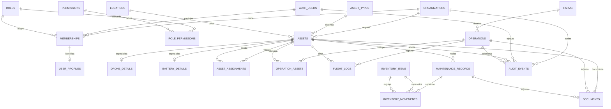

# Modelo de datos

## Modelo entidad-relacion

## Entidades principales

### Organizacion e identidad

- `organizations`: tenant de la plataforma.
- `auth_users`: identidad administrada por Supabase Auth.
- `memberships`: relacion usuario-organizacion.
- `user_profiles`: nombre visible y datos de contacto de cada miembro.
- `roles`: papel asignado al usuario.
- `permissions`: accion autorizada.
- `role_permissions`: permisos efectivamente concedidos a un rol.
- `asset_statuses`, `operation_statuses`, `maintenance_types`: etiquetas administrables
  para códigos de estado y tipo estables.

El modelo inicial puede ser monopropietario. El campo de organizacion se conserva para
aislar datos y evitar acoplar las tablas a una unica empresa.

### Activos

`assets` contiene la identidad comun:

- codigo interno
- nombre
- tipo
- marca
- modelo
- numero de serie opcional
- fecha de adquisicion
- proveedor
- factura o documento de compra
- valor
- estado
- ubicacion
- responsable
- observaciones
- estado activo/inactivo

`drone_details` contiene datos propios del dron:

- horómetro histórico acumulado, nulo mientras no se conozca
- horas desde el último mantenimiento, nulo mientras no se conozca
- ultimo mantenimiento
- intervalo preventivo siguiente

`battery_details` contiene ciclos de carga —nulos mientras no se conozcan— y datos
técnicos disponibles.

Los controles son activos normales con su propio registro de hoja de vida.
Al crear un dron o batería, un trigger crea automáticamente su ficha específica.
Los seriales son únicos dentro de la organización cuando tienen valor. Los activos
iniciales se cargan como **sin verificar**, sin inventar su estado físico ni ubicación.

### Relaciones temporales

`asset_assignments` representa relacion temporal entre activos, responsables, drones,
operaciones o ubicaciones.

Cada asignacion conserva:

- activo
- destino
- tipo de relacion
- fecha de inicio
- fecha de fin
- motivo
- usuario que la registro

No se utiliza una relacion permanente para equipos auxiliares.

### Operaciones

`operations` contiene el identificador visible, finca, municipio, ubicacion, fechas,
estado, operador principal, responsable, entrega y recepcion.

`operation_assets` representa cada activo incluido en una operacion. Conserva estado de
salida, estado de regreso, entrega, recepcion, devolucion parcial y observaciones.

Una operacion no se considera cerrada hasta recibir y verificar todos sus activos.
`create_operation_with_assets` registra la salida y actualiza la disponibilidad de todos
los activos en una única transacción. `return_operation_asset` registra cada regreso
parcial; para drones, el regreso y la lectura del horómetro se registran juntos en la
misma transacción. La operación se cierra cuando retorna el último activo.

### Vuelo

`flight_logs` contiene dron, operacion, finca, fecha, horometro inicial, horometro final,
horas calculadas y observaciones.

La lectura final debe ser mayor o igual a la inicial. La base puede generar las horas
trabajadas y acumularlas a partir de registros validados.

### Mantenimiento

`maintenance_records` contiene activo, tipo, fecha, tecnico interno o externo, empresa
externa, diagnostico, actividades, resultado, observaciones, fecha de finalizacion y
proxima intervencion.

`maintenance_parts` relaciona repuestos consumidos o instalados con cada mantenimiento.
`maintenance_plans` guarda intervalos configurables, como 50, 100 o 200 horas.

### Inventario

`inventory_items` representa repuestos gestionados por cantidad. Los componentes
serializados se gestionan como activos con identidad individual.

`inventory_movements` es un libro de movimientos con entrada, salida, instalacion,
consumo, traslado, devolucion, reparacion, retorno y baja.

El saldo no puede ser negativo; las inserciones de movimientos bloquean el artículo y
actualizan el saldo en la misma transacción. No se puede editar el saldo inicial
directamente: se registra como movimiento.

### Auditoria y archivos

`audit_events` recibe snapshots de cambios mediante triggers. No se permiten ediciones
ordinarias y cada evento se encadena con SHA-256 por organización. `verify_audit_chain`
comprueba la cadena. `audit_chain_heads` conserva la última huella.

`documents` guarda metadatos de archivos asociados a un activo, operación o
mantenimiento. Los objetos se alojan en un bucket privado bajo una ruta que comienza
con el UUID de organización y el UUID del usuario que carga el archivo.

### Fincas y ubicaciones

Las fincas pueden desactivarse sin borrarse. Las ubicaciones incluyen base principal,
taller, bodega, almacen, fincas y ubicaciones externas configurables.

## Convenciones

- Las claves primarias deben ser UUID.
- Los valores monetarios deben usar tipos exactos.
- Las fechas se almacenan como `timestamptz`.
- Los identificadores visibles pueden derivarse mediante secuencias PostgreSQL.
- Los seriales se almacenan sin editar ni normalizar datos reales.
- Los estados y tipos tienen códigos internos estables y nombres configurables en
  catálogos; los triggers protegen las transiciones críticas del ciclo de operación.
- Las tablas historicas no deben tener operaciones ordinarias de borrado.
